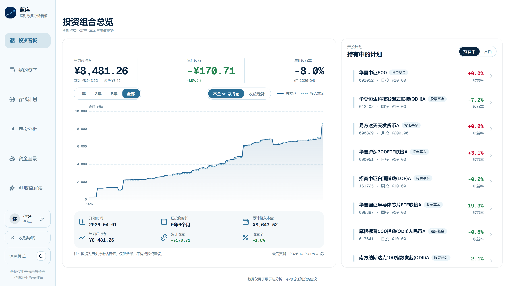
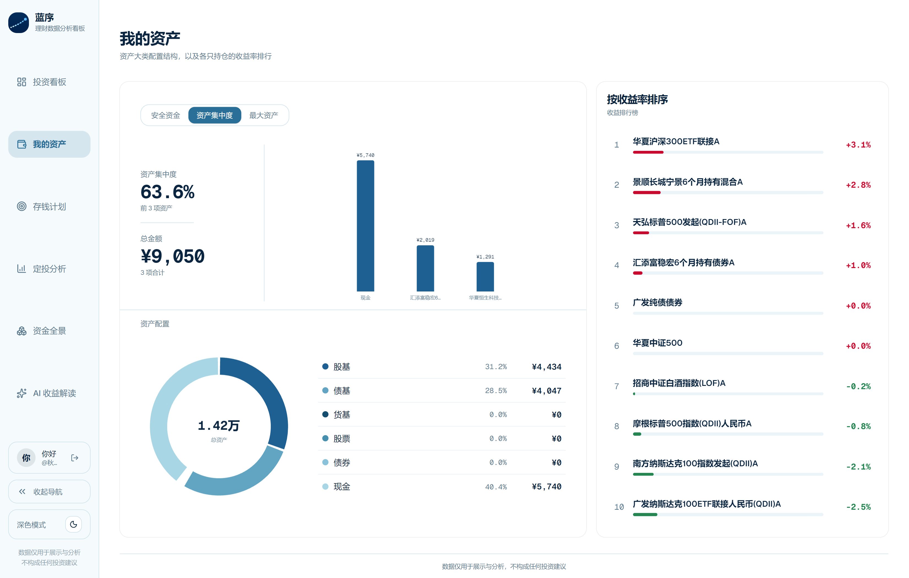
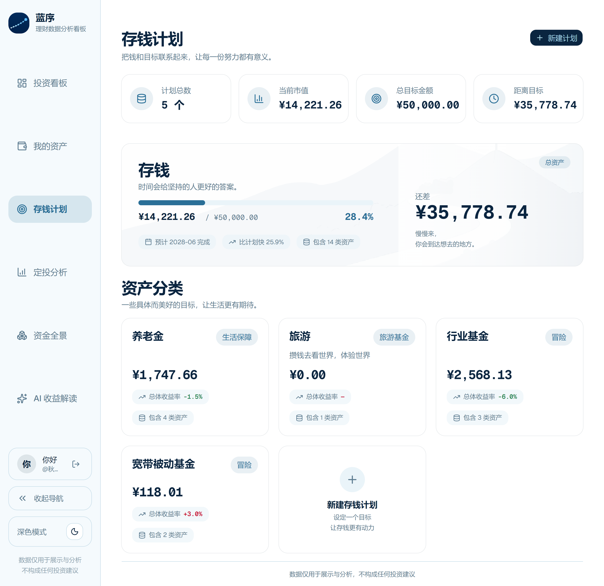
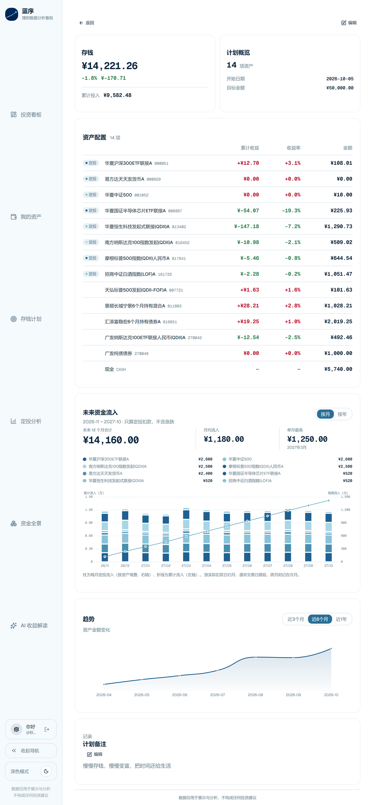
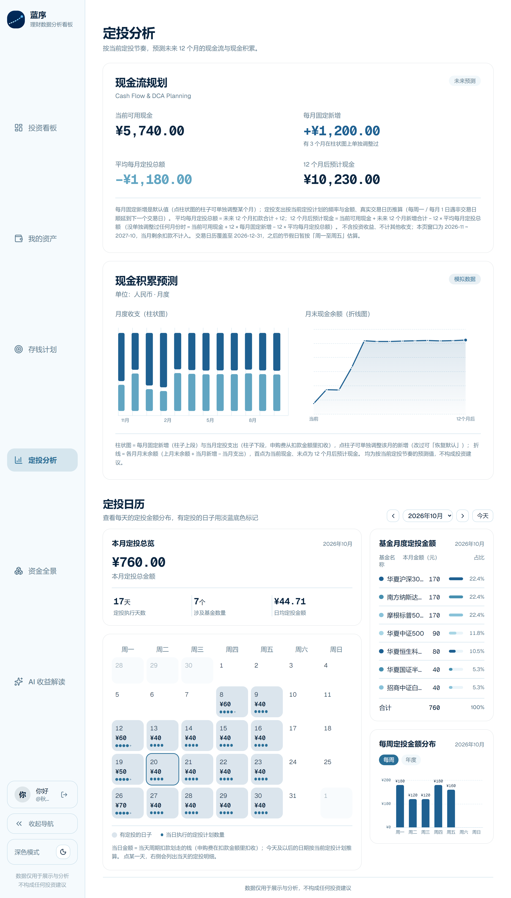
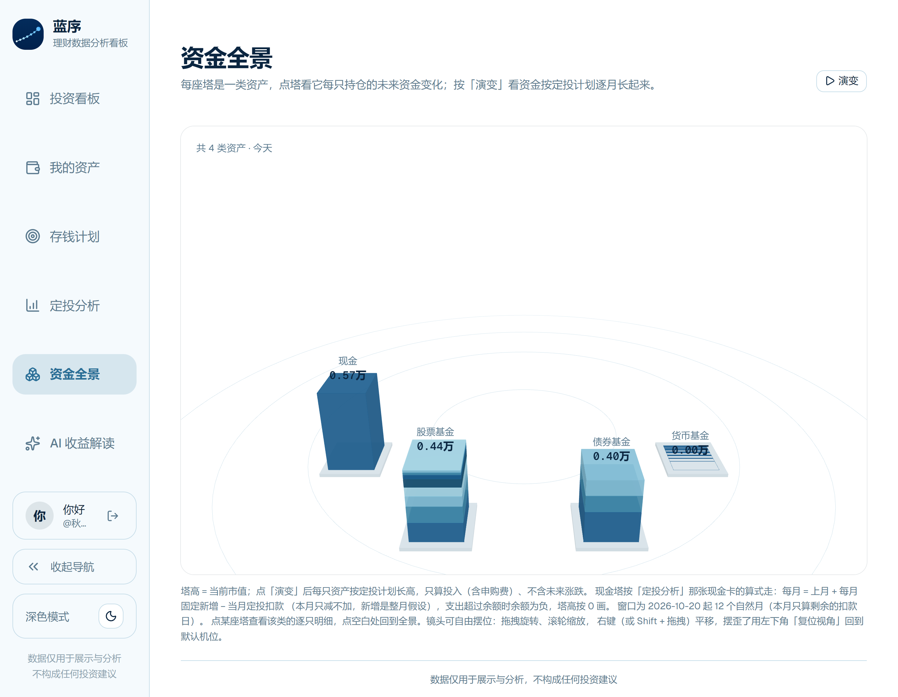
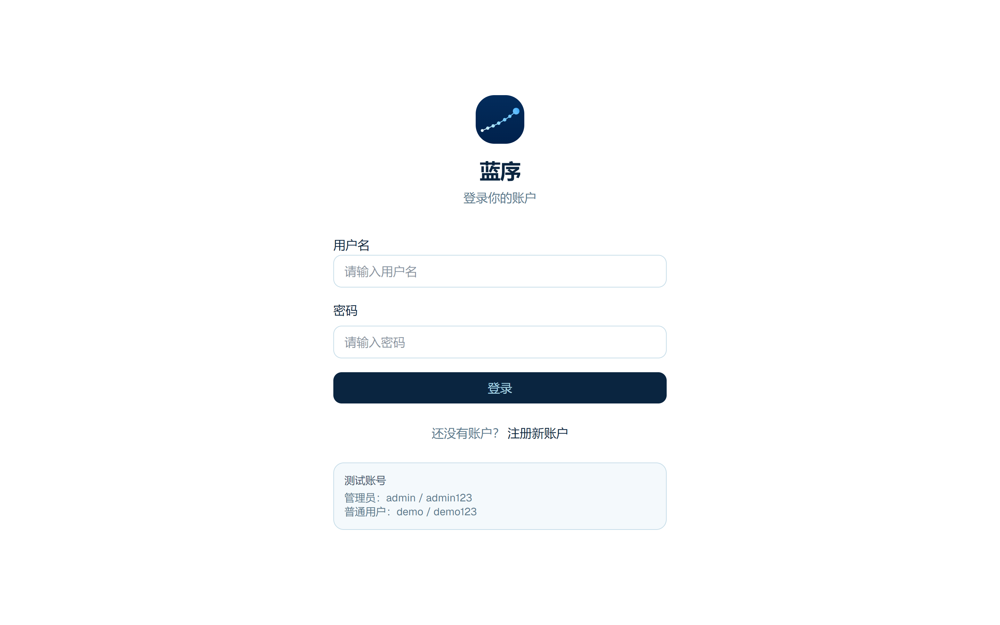

<p align="center">
  
</p>

<h1 align="center">蓝序 FinView</h1>

<p align="center">
  个人投资 / 储蓄看板 —— 把每一笔钱的变化讲清楚。
</p>

<p align="center">
  
  
  
  
  
  
</p>

---

## 简介

**蓝序（FinView）** 是一个面向个人投资者的本地投资与储蓄看板。它把基金定投、现金流水、资产配置和储蓄计划放在同一套数据模型里：每天自动生成资产序列，按真实交易日推进定投，实时抓取净值，并在看板上回答几个问题——

- 我现在到底有多少钱，赚了多少，年化多少？
- 每个月的钱花到哪里去了，未来 12 个月会剩多少？
- 离存钱目标还有多远，按当前节奏什么时候能到？
- 我的资产都分布在哪些桶里，哪只基金贡献了收益？

项目由 Spring Boot 后端、Vue 3 前端和少量 Python 数据脚本组成，默认在本机运行，数据保存在本地 MySQL 中。

## 功能特性

- **投资看板**：组合总持仓、累计收益、收益率与 XIRR 年化；本金 / 市值走势图；按单只基金下钻；定投计划列表与时间轴；调整记录的增删改查。
- **我的资产**：股票基金 / 债券基金 / 货币基金 / 股票 / 债券 / 现金六类配置环形图；资产集中度、安全资金、最大资产三种视角；按收益率排序的持仓排行榜。
- **存钱计划**：目标金额、开始日期、可选目标日期；未填目标日期时按每月存入自动推算；一个资产最多属于一个具体计划；「总资产」计划自动包含全部未归档资产；计划类型可自定义（内置总资产 / 生活保障 / 愿望）。
- **定投分析**：未来 12 个完整自然月的现金流预测（只算周期定投）；单月收入可单独覆盖；定投日历按天展示扣款金额与执行计划数，支持按周 / 按年分布。
- **资金全景**：three.js 3D 塔视图，一个桶一座塔、一只资产一截；点击塔查看该资产未来 12 个月的累计变化；自由旋转 / 平移 / 缩放视角，支持「演变」动画。
- **真实行情链路**：akshare 抓取基金历史净值；A 股交易日历决定扣款日；QDII 基金叠加美股 / 港股休市；货币基金用「每万份收益」合成复权净值。
- **现金联动**：现金是保留代码 `CASH` 的普通资产，基金申购 / 赎回 / 定投扣款会自动影响现金余额，追溯范围由可配置的联动起点控制。
- **账户与主题**：JWT 登录 / 注册；浅色 / 深色主题，图表与 3D 场景跟随主题换色。

## 界面预览

以下截图来自本地演示数据（2026 年 10 月），金额仅用于展示产品形态。

### 投资看板

组合总览、收益曲线、年化收益率，以及右侧的定投计划列表。



### 我的资产

资产配置、集中度 / 安全资金 / 最大资产视角，以及收益率排行榜。



### 存钱计划

计划总览、进度条与按类型分组的计划卡片。



### 计划详情

计划内每只资产的累计收益、收益率，以及未来 12 个月的定投流入预测。



### 定投分析

现金流规划、12 个月现金积累预测，以及可切换周 / 年分布的定投日历。



### 资金全景

按资产类别堆叠的 3D 塔视图，支持点选和未来演变动画。




<details>
<summary>登录页面</summary>



</details>

## 技术栈

| 层次 | 技术 |
| --- | --- |
| 后端 | Java 17、Spring Boot 3.3.5、Spring Security、JWT（jjwt 0.12.6）、MyBatis 3.0.4、Lombok |
| 数据库 | MySQL 8（utf8mb4），启动时执行幂等的 `schema.sql` / `data.sql` |
| 行情数据 | Python 3 + akshare（基金净值、A 股交易日历）、自维护的 NYSE / 港股休市规则 |
| 前端 | Vue 3.5、Vite 8、TypeScript 5.7、Tailwind CSS 4、Pinia 4、Vue Router 4 |
| 图表与 3D | ECharts 6 + vue-echarts 8、three.js 0.186 |
| 图标与字体 | lucide-vue、Geist / Geist Mono |

## 项目结构

```text
FinView/
├─ Backend/
│  ├─ src/main/java/com/finview/
│  │  ├─ controller/          REST 控制器与请求 / 响应 DTO
│  │  ├─ service/             业务计算（资产序列、现金流、定投、组合、全景…）
│  │  ├─ mapper/              MyBatis Mapper 接口
│  │  ├─ entity/              数据库实体
│  │  ├─ config/              JWT、安全配置、启动初始化与行情预热
│  │  └─ common/              统一响应、异常、XIRR、现金常量
│  ├─ src/main/resources/
│  │  ├─ db/                  schema.sql / data.sql（幂等，每次启动执行）
│  │  ├─ mapper/              MyBatis XML
│  │  └─ python/              fund_info.py / trade_calendar.py
│  └─ src/test/java/          单元测试（XIRR、资产序列、现金流、存钱计划…）
├─ Frontend/
│  ├─ src/
│  │  ├─ views/               登录、看板、资产、存钱计划、定投分析、资金全景
│  │  ├─ components/          图表、计划面板、3D 场景、录入 / 调整弹窗
│  │  ├─ api/                 接口模块、类型定义与本地 mock
│  │  ├─ stores/              Pinia（认证状态）
│  │  ├─ composables/         主题、请求等组合式函数
│  │  └─ router/              路由与登录守卫
│  ├─ .env / .env.local       接口地址与 mock 开关
│  └─ package.json
├─ docs/screenshots/          README 截图
├─ dev.bat                    Windows 一键启动脚本
├─ 表设计.md                  数据库表设计说明
└─ README.md
```

## 快速开始

### 环境要求

- JDK 17+
- Maven（仓库自带 `mvnw` 包装器，无需单独安装）
- Node.js 20.19+ 或 22.12+ 与 **pnpm**
- MySQL 8
- Python 3（可选，用于抓取净值和交易日历；不装也能浏览已有数据）

> 前端包管理器是 **pnpm**（仓库中有 `pnpm-lock.yaml`）。不要用 `npm install` 代替 `pnpm install`，否则可能因为依赖树解析方式不同而失败。

### 1. 数据库

确保本机 MySQL 8 已启动。应用会在首次连接时自动创建 `finview` 数据库，并在每次启动时执行：

- `Backend/src/main/resources/db/schema.sql`：幂等建表与结构迁移
- `Backend/src/main/resources/db/data.sql`：幂等种子数据

连接配置在 `Backend/src/main/resources/application.yml`（下面的密码是示例，请换成自己的）：

```yaml
spring:
  datasource:
    url: jdbc:mysql://localhost:3306/finview?...
    username: root
    password: <your-mysql-password>
```

请按自己的 MySQL 账号修改，或通过环境变量覆盖（推荐，避免把密码写进仓库）：

```bash
export SPRING_DATASOURCE_USERNAME=root
export SPRING_DATASOURCE_PASSWORD=你的密码
# 需要时也可以覆盖 SPRING_DATASOURCE_URL
```

### 2. 启动后端

```bash
cd Backend
./mvnw -o spring-boot:run        # Git Bash / macOS / Linux
.\mvnw.cmd -o spring-boot:run    # Windows cmd / PowerShell
```

- 默认端口 `8080`，统一前缀 `/api`，即 `http://localhost:8080/api`
- `-o` 表示离线构建；如果刚往 `pom.xml` 里加了新依赖，去掉 `-o` 再启动一次
- 启动时若遇到 `ConflictingBeanDefinitionException`，先执行 `./mvnw -o clean` 再启动（历史包路径残留的 `.class` 会导致重复 bean）

### 3. 启动前端

```bash
cd Frontend
pnpm install
npm run dev
```

打开 <http://localhost:5173>。

前端默认直连真实后端，配置在 `Frontend/.env` 与 `.env.local`：

```dotenv
VITE_USE_MOCK=false
VITE_API_BASE_URL=http://localhost:8080/api
```

把 `VITE_USE_MOCK` 改成 `true` 可以切到内置 mock 数据，方便只调试界面。

### 4. 一键启动（Windows）

双击根目录的 `dev.bat`，会分别在两个窗口启动后端与前端，并自动打开浏览器。只想检查端口占用而不启动：

```bash
dev.bat check
```

### 5. 安装 Python 数据依赖（可选）

抓取基金净值和交易日历需要：

```bash
pip install akshare
```

akshare 会一并安装 `pandas`、`requests`、`py_mini_racer` 等依赖。若 `python` 不在 PATH 中，可以在 `application.yml` 里配置：

```yaml
finview:
  python:
    cmd: python            # 或 python3 / 绝对路径
    # script-dir: 可选，默认 Backend/src/main/resources/python
```

不安装 Python 时，已有净值和资产序列仍可正常展示，只是无法自动更新最新市值。

### 默认账号

启动后可直接使用内置账号登录：

| 账号 | 密码 | 说明 |
| --- | --- | --- |
| `admin` | `admin123` | 管理员 |
| `demo` | `demo123` | 普通用户 |

> 这两个内置账号没有任何业务数据，适合验证注册 / 登录流程。要看完整界面，请注册自己的账号，或通过接口录入几笔定投记录。README 中的截图使用的是本地演示数据。

## 配置说明

| 配置项 | 位置 | 说明 |
| --- | --- | --- |
| `VITE_USE_MOCK` | `Frontend/.env` | `false` 走真实后端，`true` 走本地 mock |
| `VITE_API_BASE_URL` | `Frontend/.env` | 后端基础地址，默认 `http://localhost:8080/api` |
| `spring.datasource.*` | `Backend/src/main/resources/application.yml` | MySQL 连接信息 |
| `jwt.secret` | 同上 | JWT 签名密钥，生产环境务必通过 `JWT_SECRET` 覆盖 |
| `jwt.expiration-ms` | 同上 | Token 有效期，默认 24 小时 |
| `finview.cash.link-from` | 同上 | 现金与基金买卖的联动起点，只有该日期起的交易才影响现金余额 |
| `finview.python.cmd` | 同上 | Python 可执行文件名或路径 |

## 核心口径

这一节记录几个容易误解的业务规则，改代码前建议先读。

### 资产序列 `asset_series`

`asset_series` 不是手工维护的表，而是 `SeriesService` 按交易事件逐日生成的「本金 / 手续费 / 市值」快照，是走势图、资产总览和组合曲线的共同数据源。以下时机会重算：

- 登录 / 注册时的增量推进；
- 新增、编辑、删除调整记录；
- 抓到新的基金净值；
- 手动调用 `POST /api/funds/{code}/series` 或 `POST /api/funds/series`。

### 定投与交易日

- 日定投只在交易日扣款；周定投 / 月定投遇到非交易日顺延到下一个交易日。
- 交易日来自 A 股交易日历（`trade_calendar.py`，启动时预热，每日刷新）。
- QDII 基金还会叠加标的市场休市：`asset.market` 标为 `us` 或 `hk` 后，扣款日 = A 股交易日 ∩ 标的市场开市日。
- 申购费从扣款金额中扣除，净额才计入本金与份额；费率 `asset.rate` 是百分数（`0.12` 表示 0.12%），不足 1 分按 1 分计。

### 收益与收益率

- 累计收益 = 市值 − 本金 − 累计手续费。
- 收益率 = 累计收益 / 累计投入；累计投入 = Σ 历年买入的「净投入 + 手续费」，卖出日不计入。
- 年化收益率使用后端 XIRR（现金流 = −(金额 + 手续费)，末日 + 市值，ACT/365）；持有不足 30 天或无解时返回空，前端显示「—」。
- 卖出金额 ≥ 当日持仓市值时按清仓处理：份额与市值归零，但本金和手续费照常累计，累计收益跨轮次连续。

### 货币基金

货币基金没有单位净值走势，`fund_info.py` 会用东财 `pingzhongdata` 中的「每万份收益」合成复权净值：

```text
净值_t = Π(1 + 万份收益_t / 10000)
```

合成净值保留 8 位小数，并逐日包含周末与节假日（货币基金节假日也计息）。

### 现金

- 现金是保留代码 `CASH` 的普通资产，手工记录复用 `adjustments`：正数 = 现金进账（action=3），负数 = 现金出账（action=4），金额一律存绝对值。
- 现金余额 = Σ 手工记录 − Σ 联动起点之后各基金的 (金额 + 手续费)。
- 现金只写 `asset` 快照，不写 `asset_series`；它计入「我的资产」和现金桶，但不出现在投资看板的持仓曲线中。

### 存钱计划

- 计划与资产通过 `plan_asset` 关联：一个计划可以挂多个资产，但一个资产最多属于一个具体计划。
- 「总资产」计划（`type=asset`）不查关联表，默认包含该用户全部未归档资产。
- 计划完成度与当前金额不落库，读接口按关联资产的最新市值实时计算。
- 目标日期选填；只填目标金额和每月存入时，按 `⌈目标金额 ÷ 每月存入⌉` 个月自动推算并落库。
- 计划类型分为 `code`（稳定标识）与 `name`（显示名），改名不影响计划；内置 `asset` / `life` / `wish` 三种类型。

### 未来现金流与资金全景

- 定投分析预测窗口为「下月起 12 个完整自然月」，只统计周期定投；金额 = 配置金额（含从金额中扣除的申购费）。
- 定投日历与未来现金流预测共用 `SeriesService.fold`，因此与真实扣款日、顺延、QDII 休市、申购费完全同源。
- 资金全景以当前市值为塔高基准，并按「当前市值 + 未来累计投入」的最大值统一缩放；「演变」展示的累计变化只包含定投投入，不含未来涨跌。现金塔按「每月固定新增 − 当月定投扣款」逐月推算，余额可以为负。

## API 一览

后端所有接口统一返回 `{ code, message, data }`，`code = 0` 表示成功；除登录 / 注册外均需要 `Authorization: Bearer <token>`。

| 模块 | 主要接口 | 说明 |
| --- | --- | --- |
| 认证 | `POST /auth/login`、`POST /auth/register`、`GET /auth/me` | JWT 登录、注册、当前用户 |
| 基金 | `GET /funds`、`GET /funds/{id}`、`PUT /funds/{id}`、`GET /funds/leaderboard` | 基金列表、详情、编辑元数据、收益排行 |
| 序列 | `POST /funds/{id}/series`、`POST /funds/series` | 重算单只 / 全部资产序列 |
| 组合 | `GET /portfolio/series` | 组合本金与市值走势 |
| 资产 | `GET /assets/summary`、`GET /assets/distribution` | 资产总览、配置分布 |
| 记录 | `GET/POST/PUT/DELETE /adjustments` | 买入、卖出、定投开始 / 结束、调整 |
| 存钱计划 | `GET/POST /savings/plans`、`GET /savings/plans/{id}`、`POST/DELETE /savings/plans/{id}/assets` | 计划 CRUD 与资产关联 |
| 计划类型 | `GET/POST/PUT/DELETE /savings/plan-types` | 自定义计划类型 |
| 现金流 | `GET /cashflow/forecast`、`GET /cashflow/calendar`、`PUT /cashflow/monthly-inflow` | 12 个月预测、定投日历、每月新增 |
| 资金全景 | `GET /visualization/panorama` | 3D 塔视图数据 |
| 净值 | `POST /nav/refresh` | 立即抓取最新净值并重算 |

## 数据库表

| 表 | 作用 |
| --- | --- |
| `user` | 用户与 JWT 身份、资产序列推进水位、默认每月新增 |
| `asset` | 资产主数据（基金 / 现金），含费率、类型、标的市场、归档状态 |
| `adjustments` | 定投开始 / 结束、买入、卖出等交易记录 |
| `nav_trend` | 每只基金的历史单位净值 |
| `asset_series` | 由交易与净值逐日生成的资产序列快照 |
| `saving_plans` | 存钱计划 |
| `plan_asset` | 计划与资产的关联 |
| `saving_plan_types` | 可自定义的计划类型 |
| `monthly_inflow_override` | 定投分析里按月的收入覆盖 |

表结构以根目录的 [`表设计.md`](表设计.md) 为准。

## 测试与构建

后端：

```bash
cd Backend
./mvnw -o test
```

前端：

```bash
cd Frontend
npm run type-check
npm run build
```

## 说明与限制

- 净值与交易日历来自第三方公开数据（东方财富 / 新浪，经由 akshare），网络异常时只记录日志，不阻塞接口；QDII 净值可能滞后数个交易日。
- A 股交易日历通常只覆盖到当年年底，次年日历发布前，跨年扣款日按「周一至周五」估算。
- 口径变更（费率、周期、交易日规则）不会自动回填历史，需要触发一次资产序列重算。
- 本项目为个人本地工具，数据仅用于展示与分析，不构成任何投资建议。
